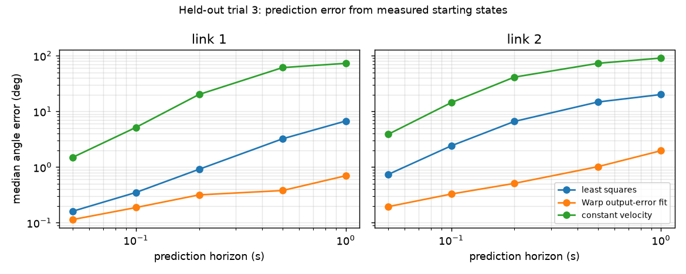
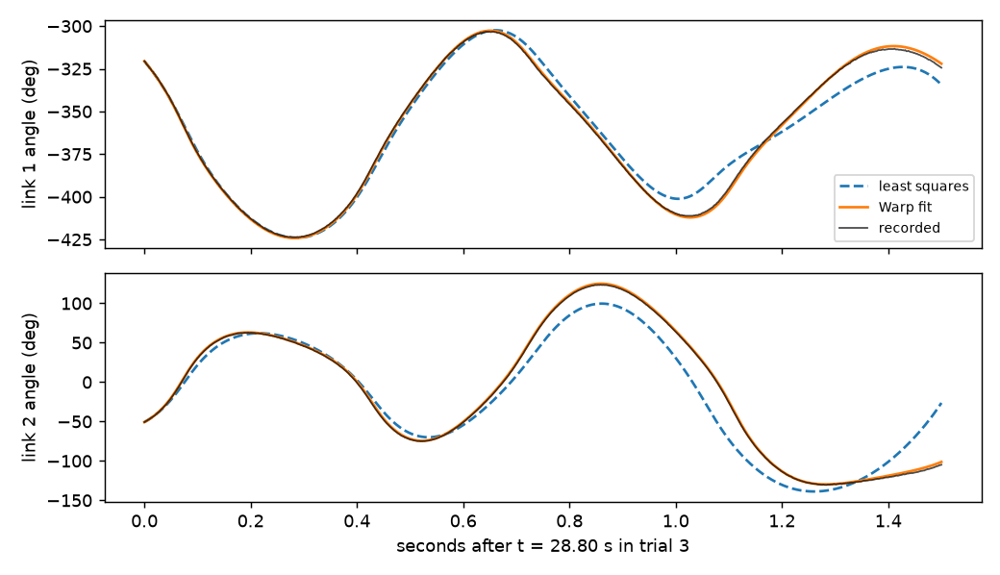
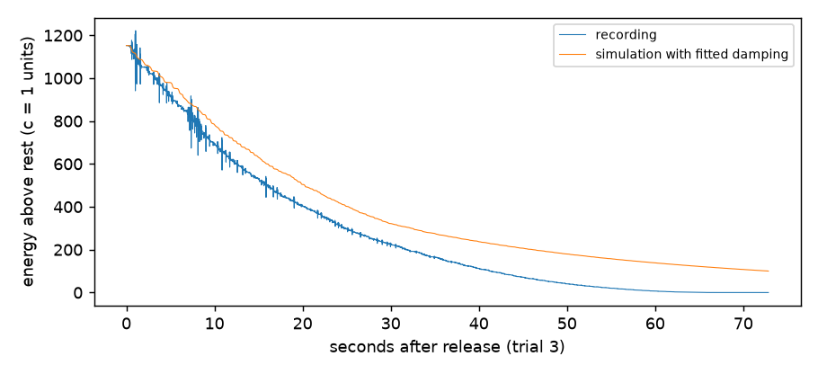

# pendulab

A double-pendulum simulator in C++17 and Python, checked against reference solutions, then
fitted to **real recordings of a physical double pendulum** using a differentiable simulator
written in [NVIDIA Warp](https://github.com/NVIDIA/warp). The fitted model is judged by how well it
predicts a recording it never saw.

All numbers below come from `results/*.json`, produced by `scripts/experiments.py` on an Apple M4
(Warp runs on the CPU there; no CUDA device was used).

## Results

### 1. Fitting a real pendulum: least squares vs. differentiable simulation

Data: three recorded trials of the same pendulum (video-tracked angles of both links, 500 samples/s,
about 70 s of free swinging each after release). Trials 1 and 2 are used for fitting; trial 3 is held out.

Two ways to identify the 6 unknown parameter ratios (inertias, coupling, gravity terms, joint damping):

- **Least squares (equation error).** The equations of motion are linear in the parameters, so with
  numerically differentiated velocities and accelerations this is one `lstsq` call.
- **Warp (output error).** 1,449 windows of 0.2 s are cut from the recordings. Each window is simulated
  with RK4 from its measured starting state and compared with the measured angles. The parameters
  (and each window's starting velocity) are fitted by Adam, using gradients from Warp's reverse-mode
  autodiff through every integration step, for 4,000 iterations.

**Predicting the held-out trial** (`results/evaluation.json`): 288 start points, 0.25 s apart. Each model
is integrated from the measured state and compared with what the real pendulum did.

| horizon | least squares: median error (link 1 / link 2) | Warp fit: median error | both links within 5°: LS vs Warp |
|---|---|---|---|
| 0.1 s | 0.35° / 2.41° | 0.19° / 0.33° | 73% vs 100% |
| 0.2 s | 0.91° / 6.60° | 0.32° / 0.51° | 41% vs 96% |
| 0.5 s | 3.22° / 14.73° | 0.38° / 1.02° | 26% vs 86% |
| 1.0 s | 6.71° / 20.08° | 0.70° / 1.97° | 22% vs 70% |





Removing the fitted joint damping drops the 1.0 s "within 5°" rate from 70% to 56%, so the damping
terms carry real information.

**Why least squares does worse.** Its answer depends on how the noisy angle data is smoothed before
differentiating twice. Changing only the Savitzky-Golay window from 11 to 51 samples moves the
upper-link inertia ratio `a` from 0.07 to 6.36 (`results/fit.json`, `window_sensitivity`). No single
window is "right"; smoothing biases the accelerations, and too little smoothing lets noise dominate.
The output-error fit never differentiates the data: it only compares simulated and measured angles.

**Is the Warp fit stable?** Fitting each of the three trials separately gives the same parameters to
within 0.2% for the four inertia and gravity terms (`a` 7.385–7.387, `b` 1.583–1.584, `d` 485.9–486.5,
`e` 90.42–90.50, with `c` = 1). The damping terms vary more (pivot 0.372–0.388, elbow 0.017–0.023).

### 2. Where the model is wrong: energy loss (`results/energy.json`)

The energy of the recording (computed with the fitted parameters) is compared with a 73-second
simulation from the same release state. Chaos makes the trajectories differ after a second or two,
but total energy changes slowly enough to compare.

| seconds after release | 0 | 10 | 20 | 40 | 60 |
|---|---:|---:|---:|---:|---:|
| recorded energy above rest | 1151 | 692 | 404 | 112 | 7 |
| simulated, fitted viscous damping | 1151 | 783 | 505 | 238 | 138 |



The starting energies match, which is a check on the fitted gravity terms: held upright, the energy above rest should be 2(d + e) = 1153.
But the real pendulum comes to rest, and the model doesn't. Viscous damping (torque proportional to
speed) fades as the pendulum slows down. The recording keeps losing energy at low speed, which
points to dry (Coulomb) friction in the bearings. The short-horizon fit can't see this, because over
0.2 s the friction torque is small next to gravity. Adding a Coulomb term is the next step.

### 3. Simulator checks against reference solutions (`results/integrators.json`)

Convergence on a large, strongly nonlinear swing (0.5 s, error against an RK4 reference with 65,536 steps):

| integrator | error at 1024 steps | at 2048 steps | observed order | expected |
|---|---:|---:|---:|---:|
| explicit Euler | 1.5e-1 | 7.2e-2 | 1.01 | 1 |
| semi-implicit Euler | 5.1e-2 | 2.5e-2 | 1.00 | 1 |
| implicit midpoint | 8.0e-6 | 2.0e-6 | 2.00 | 2 |
| RK4 | 5.9e-10 | 3.9e-11 | 3.93 | 4 |

Energy error over 60 s without damping (dt = 1 ms, relative to the size of the potential):
explicit Euler 2.5, semi-implicit Euler 0.33, implicit midpoint 6.0e-5, RK4 2.5e-8. At this small time
step RK4's slow energy drift stays below implicit midpoint's bounded oscillation. Symplectic
methods win over much longer runs or larger steps, not here.

The C++ tests also check that:
- the point-mass special case matches the textbook equations (to 6e-15);
- small swings oscillate at the frequencies predicted by the linearized eigenvalue problem (to about 1e-6);
- implicit midpoint retraces its path when run backwards;
- energy never increases when damping is on.

The C++ and NumPy implementations agree to 8.7e-13 rad over 2 s, and Warp agrees with NumPy to better than 1e-10.

## Bugs found along the way

- **Release detection (the biggest one).** Each recording starts with the pendulum hanging still,
  then lifted to upright *by hand*, held, and let go. My first detector took "the first time the
  upper link moves" as the release, which put 2.2–2.7 s of hand-driven motion per trial into the
  fit. The giveaway was the energy check: measured energy *rose* after "release", which can't
  happen to an unpowered pendulum. A second attempt ("first time near upright") was still too
  early. The final version finds the longest stretch where both links are upright and still. After
  the fix, the training loss fell from 3.2e-4 to 1.3e-5. The least-squares pivot damping, which had come out
  negative (physically impossible), became positive; I had first blamed that on noisy derivatives.
- **Wrong gradients from a Warp loop.** The integration kernel originally ran its RK4 substeps in
  `for _ in range(substeps)` with a runtime bound. The gradients were 2–7% off from finite differences, with no
  error or warning. Unrolling the loop at compile time (`wp.static`) brought the agreement under 1e-6 relative
  for every parameter on a test problem. `tests/test_warp.py` now checks gradients against finite differences.
- **A convergence test that tested the wrong thing.** RK4 first measured "order 2.6" because the
  chosen step sizes put its error at floating-point round-off, and then "order 3.7" because they
  were still too coarse for this fast-moving system. The step sizes are now chosen per integrator.

## How it works

```
cpp/include/pendulab/model.hpp   equations of motion, energy, 4 integrators, normal modes (header-only)
cpp/tools/dpsim.cpp              CLI: integrate and print a CSV trajectory
cpp/tests/test_sim.cpp           convergence, energy, normal-mode, reversibility tests
src/pendulab/model.py            NumPy reference model (vectorized over many windows)
src/pendulab/cpp.py              runs dpsim; used for the C++-vs-NumPy cross-check
src/pendulab/data.py             loads trials, finds the release, smoothed derivatives
src/pendulab/ident.py            equation-error least squares
src/pendulab/warp_fit.py         Warp kernels: batched RK4 rollouts, loss, Adam fit via wp.Tape
src/pendulab/evaluate.py         held-out prediction error by horizon
scripts/experiments.py           regenerates everything in results/
```

The model uses rigid links (not point masses) and absolute angles from hanging straight down:

```
a q1'' + b cos(q1-q2) q2'' + b sin(q1-q2) q2'^2 + d sin q1 + beta1 q1' - beta2 (q2'-q1') = 0
b cos(q1-q2) q1'' + c q2'' - b sin(q1-q2) q1'^2 + e sin q2 + beta2 (q2'-q1')            = 0
```

with `a` = I1 + m2 l1², `b` = m2 l1 c2, `c` = I2, `d` = (m1 c1 + m2 l1) g, `e` = m2 c2 g. Motion only
determines ratios of these, so `c` is fixed to 1.

## Setup and usage

Requires a C++17 compiler, CMake ≥ 3.20, [uv](https://docs.astral.sh/uv/) and Python 3.12.

```bash
cmake -S cpp -B cpp/build && cmake --build cpp/build && ./cpp/build/test_sim
uv sync
uv run pytest
./cpp/build/dpsim --integrator implicit_midpoint --dt 0.001 --steps 5000 \
    --state 2.0,-1.0,0,0 --params 7.385,1.583,1,485.9,90.46,0.38,0.02 --every 100
uv run python scripts/fetch_data.py      # re-download and verify the data (already committed)
uv run python scripts/experiments.py     # regenerate results/ (about 25 min of fitting on an M4 CPU)
```

`warp_fit.py` uses a CUDA device automatically when Warp finds one; that path hasn't been run.

## Design decisions

- **Short windows, many of them.** The double pendulum is chaotic, so a tiny parameter error grows
  exponentially, and a fit over long trajectories has a useless, jagged loss surface. 0.2 s windows keep
  the loss smooth; 1,449 of them cover the recordings.
- **Starting velocities are free variables.** Measured angles are clean, but velocities come from
  numerical differentiation. Letting each window adjust its starting velocity stops velocity
  errors from being absorbed into the physical parameters. At test time, every model gets the same
  smoothed-derivative velocities, so the comparison is fair.
- **Wrap-safe loss.** `2 − 2cos(error)` behaves like error² for small errors and doesn't jump when
  an angle wraps past ±180° (the lower link spins many full turns).
- **Relative parametrization.** Parameters differ by four orders of magnitude (`d` ≈ 486, `beta2` ≈ 0.02),
  so Adam updates relative changes, and the damping terms are kept non-negative.
- **One set of equations, three implementations** (C++, NumPy, Warp), each checked against the others.

## Limitations

- **No dry friction.** The energy check shows the model's main gap (above).
- **One pendulum, one camera setup.** The fitted values are dimensionless ratios. Without the
  physical masses and lengths I can't check them against the hardware directly.
- **Tracking noise isn't modelled.** The dataset includes per-sample tracking uncertainty, which is unused here.
- **No GPU run.** Warp ran on the CPU only, and the CUDA path is untested.
- **The encoder recordings that come with the dataset aren't used.** They need the authors' MATLAB calibration.

## Testing

- **C++:** `cpp/tests/test_sim.cpp` has 11 checks, run by CTest and compiled with `-Wall -Wextra -Wpedantic -Werror`.
- **Python** (`uv run pytest`) has 23 tests:
  - the model's energy and damping behaviour, and that parameters only matter up to scale;
  - C++ vs NumPy agreement, all four integrators through the CLI, and rejection of bad input;
  - least squares recovering known parameters from clean synthetic data, and its sensitivity to smoothing with noise;
  - release detection on a synthetic lift-hold-release recording;
  - Warp vs NumPy agreement, Warp gradients vs finite differences, and recovery of known parameters to within 2% from a start 10% off.
- **CI** (GitHub Actions, Ubuntu with GCC) builds and tests the C++ code, then runs ruff and pytest.

## Data & licensing

`data/pendulum.npz` holds the video-tracked link angles from: A. Myers, F. Khasawneh, J. Tempelman,
D. Petrushenko, *Low-cost double pendulum for high-quality data collection with open-source video
tracking and analysis*, Mendeley Data, V1 (2020), doi:10.17632/7yd2ntbh3w.1, licensed
[CC BY 4.0](http://creativecommons.org/licenses/by/4.0). Changes: only the mean angle of each link was kept,
converted from degrees to radians. `scripts/fetch_data.py` downloads the original archive, checks
its SHA-256 and rebuilds the file. The code is MIT licensed (`LICENSE`).

## AI assistance disclosure

This project was written with AI assistance (Claude, by Anthropic). Commits carry a
`Co-Authored-By` trailer. Every number in this README comes from running the committed code
(`results/`).
